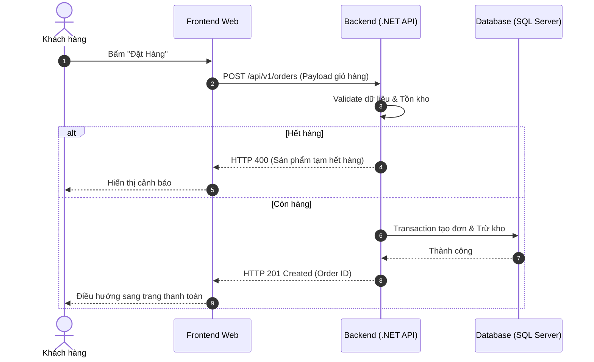

# 📋 Cẩm Nang Business Analyst (BA) Trong Team

Tài liệu này định nghĩa chuẩn mực công việc và giao tiếp giữa **Business Analyst (BA)** và đội ngũ **Kỹ thuật (Dev/Tester)**.

---

## 1. Chuẩn Viết User Story (Agile/Scrum)

Mỗi User Story cần tuân theo cấu trúc chuẩn:

```text
Là một [Role / Đối tượng người dùng],
Tôi muốn [Hành động / Tính năng mong muốn],
Để [Mục đích / Giá trị mang lại].
```

### Ví dụ Thực Tế:
> **Là một** Khách hàng đã đăng nhập,  
> **Tôi muốn** lọc lịch sử đơn hàng theo khoảng ngày và trạng thái giao hàng,  
> **Để** tôi có thể tra cứu hóa đơn phục vụ quyết toán thuế nhanh chóng hơn.

---

## 2. Tiêu Chí Chấp Nhận (Acceptance Criteria - AC)

Đội BA nên áp dụng chuẩn cú pháp **Given - When - Then** (Gherkin format) để Dev và Tester có cùng cách hiểu:

```gherkin
Kịch bản: Lọc đơn hàng thành công theo ngày
  GIVEN Người dùng đang ở màn hình "Lịch sử đơn hàng"
  WHEN Người dùng chọn ngày bắt đầu "01/01/2026" và ngày kết thúc "31/01/2026"
  AND Bấm nút "Tìm kiếm"
  THEN Hệ thống hiển thị danh sách các đơn hàng có ngày tạo nằm trong khoảng thời gian trên
  AND Nếu không có kết quả, hiển thị thông báo "Không tìm thấy đơn hàng nào".
```

---

## 3. Biểu Đồ Nghiệp Vụ Mẫu (Mermaid Diagram)

BA có thể vẽ trực tiếp biểu đồ vào tài liệu Markdown bằng mã Mermaid:



---

## 4. Checklist Cho BA Trước Khi Chuyển Giao Cho Dev (Sprint Planning)

- [ ] Đã có Wireframe / Prototype Figma liên kết kèm theo.
- [ ] Đã làm rõ các trường hợp ngoại lệ (Edge cases), validate độ dài, định dạng dữ liệu.
- [ ] Đã có định nghĩa quyền hạn (Role-based access control - ai được xem/sửa tính năng này).
- [ ] Đã thống nhất với Tech Lead về tính khả thi kỹ thuật.
