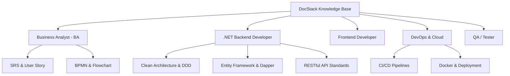

# 📚 Kho Tri Thức Nội Bộ Team - DocStack

Chào mừng tất cả các thành viên (Dev, BA, Tester, DevOps, PM) đến với hệ thống tài liệu và cẩm nang hướng dẫn kỹ thuật nội bộ của team.

Trang web này được xây dựng nhằm chuẩn hóa quy trình, chia sẻ tri thức (Knowledge Base) và hướng dẫn onboarding cho thành viên mới một cách nhanh chóng nhất.

---

## 🧭 Cấu Trúc Tài Liệu

Hệ thống tài liệu được phân cấp theo từng vai trò và lĩnh vực chuyên môn:

### 1. 📋 [Business Analyst (BA)](/docs/ba/ba-overview)
- Khung quy trình phân tích nghiệp vụ, làm việc với Product Owner / Khách hàng.
- Chuẩn viết **User Story**, Tiêu chí chấp nhận (**Acceptance Criteria - AC**), **BRD**, **SRS**.
- Bộ quy chuẩn vẽ biểu đồ luồng nghiệp vụ (BPMN, Flowchart, Activity Diagram, Use Case).

### 2. ⚡ [.NET Backend Developer](/docs/dotnet-backend/overview-guidelines)
- Chuẩn kiến trúc dự án (.NET 8/9/10: **Clean Architecture**, CQRS, MediatR, Repository Pattern).
- Quy chuẩn thiết kế **RESTful Web API** (Chuẩn status code, error response, pagination).
- Tối ưu CSDL: **Entity Framework Core**, **Dapper**, Indexing, Caching với Redis.
- Bảo mật: JWT Authentication, Refresh Token, Policy-based Authorization.

### 3. 🎨 [Frontend Developer](/docs/frontend/frontend-overview)
- Chuẩn xây dựng UI/UX (React, Vue, Next.js, Tailwind CSS).
- Quản lý State, call API và chuẩn giao tiếp với Backend .NET.

### 4. 🚀 [DevOps & Triển khai](/docs/devops-ci-cd/cicd-docker-guide)
- Dockerfile chuẩn tối ưu cho ứng dụng ASP.NET Core & React.
- Pipeline CI/CD tự động (GitHub Actions / GitLab CI).
- Hướng dẫn cấu hình môi trường Dev, Staging, Production.

### 5. 🧪 [QA & Kiểm thử](/docs/qa-testing/qa-overview)
- Quy trình Test Case, Bug Report template.
- Tự động hóa kiểm thử (API Automation Testing với Postman/Playwright).

---

## 💡 Đóng Góp Tài Liệu

Tất cả thành viên đều được khuyến khích cập nhật và viết tài liệu mới:
1. Tạo branch mới từ `main`.
2. Tạo file `.md` hoặc `.mdx` trong thư mục tương ứng trong `docs/`.
3. Tạo Pull Request (PR) để reviewer xem qua và merge.
